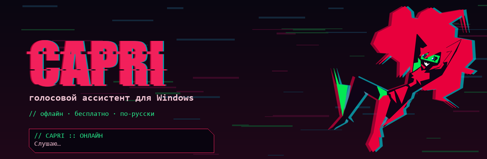
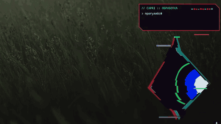
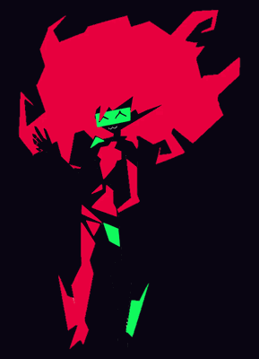
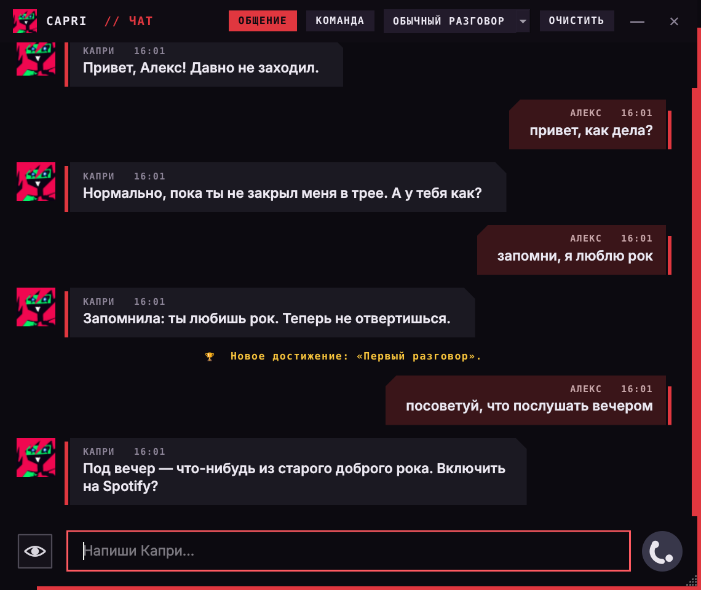
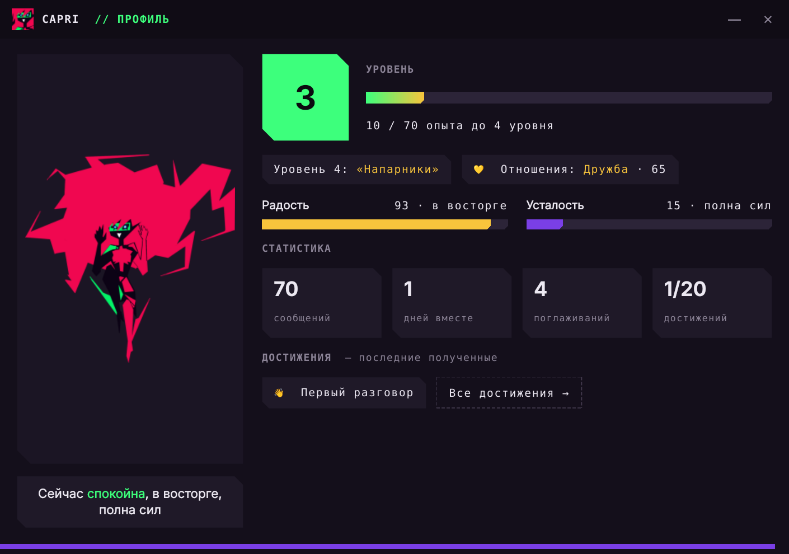
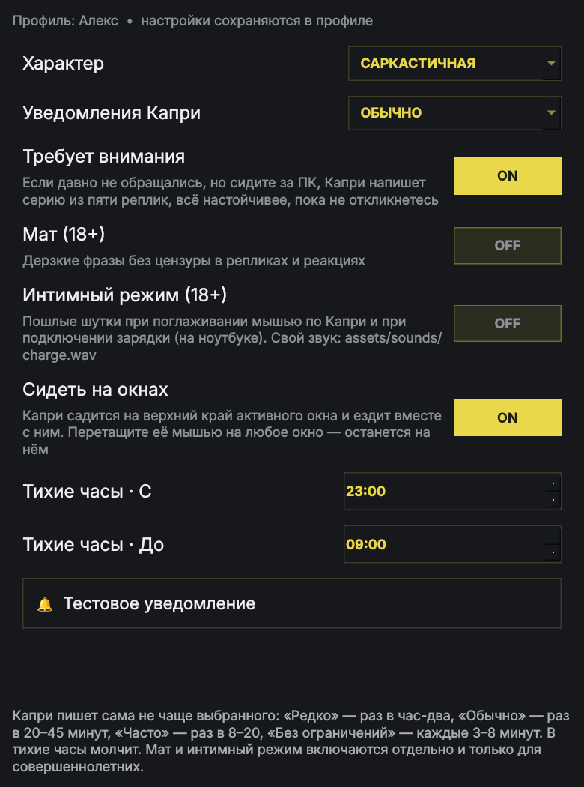
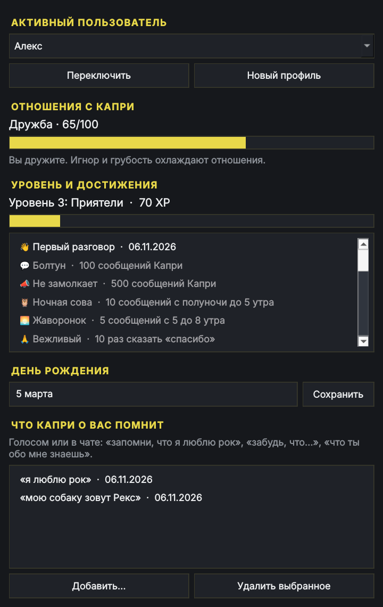
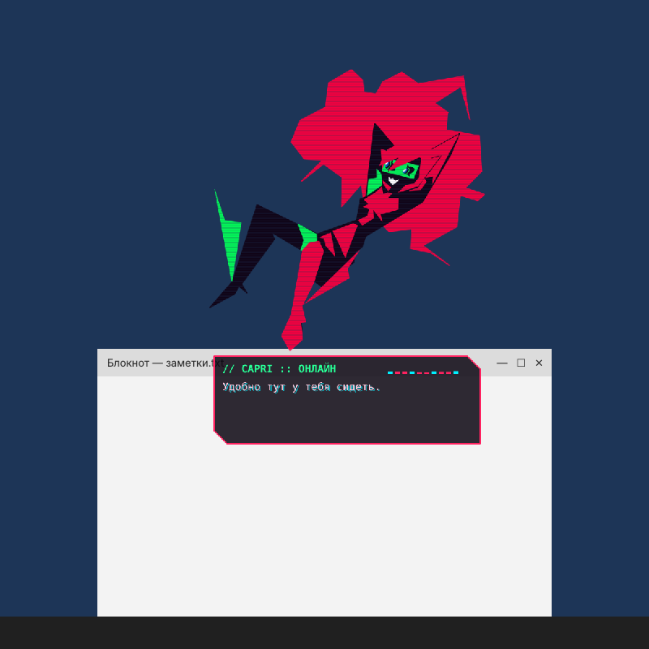
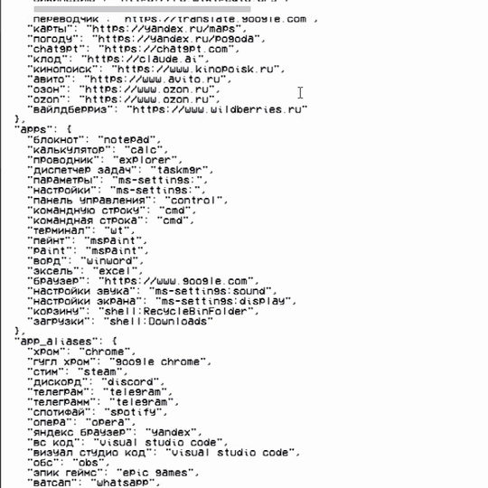
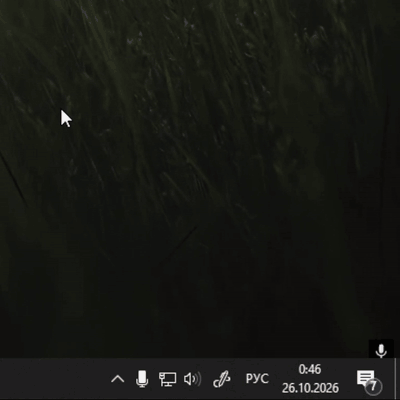

<p align="center">
  
</p>

<p align="center">
  
  
  
  
  
  
</p>

<p align="center">
  <b>Капри</b> — голосовой ассистент в стиле киберпанка. Живёт поверх окон, сидит на них, появляется с глитч-вспышками,<br>
  слушает команды на русском, управляет компьютером, болтает, помнит тебя и обижается, если её игнорировать.
</p>

<h2 align="center">Этот проект сделан с помощью ИИ</h2>

<p align="center">
  Код, оформление и документация написаны вместе с нейросетью.
</p>

> **О характере Капри.** Её характер собран из разных источников. Она болтает через нейросеть, поэтому её поведение в диалогах
> может быть кринжовым.

<p align="center">
  
  &nbsp;
  
</p>

---

## Новый интерфейс

<p align="center">
  <br>
  <sub><b>Чат.</b> Ответ печатается по мере генерации, пока Капри «думает…». Режимы «Общение» и «Команда», ролевые режимы,
  история сохраняется. Вместо «ты» — имя из твоего профиля.</sub>
</p>

<p align="center">
  <br>
  <sub><b>Профиль Капри.</b> Уровень и опыт, отношения, радость и усталость, что она делает прямо сейчас,
  статистика и последние достижения.</sub>
</p>

<p align="center">
  
  &nbsp;
  <br>
  <sub><b>Настройки</b> (характер, частота сообщений, 18+, тихие часы, сидение на окнах) и <b>профиль пользователя</b>
  (отношения, достижения, день рождения, что Капри о тебе помнит).</sub>
</p>

<p align="center">
  <br>
  <sub><b>Капри сидит на окнах</b> — забирается на верхний край активного окна и ездит вместе с ним.</sub>
</p>

---

## Что умеет

### Команды голосом и в чате

| | |
|---|---|
| **Интернет** | открывает сайты, ищет в Google, картинки и информацию — с пересказом из Википедии |
| **YouTube** | «открой (ваше видео)» — сразу включает первое видео; поиск прямо на YouTube |
| **Музыка и видео** | пауза, следующий трек, «что играет», перемотка, **«поставь на 3:14»**, «начни с 27-й минуты» |
| **Telegram и текст** | «открой телеграм, чат папа, напиши привет» — находит чат, печатает и отправляет |
| **Программы и окна** | открывает и закрывает программы, завершает процессы, вкладки, сворачивание, прокрутка страниц |
| **Клавиши** | «нажми вин таб», «контрол шифт эскейп», «альт эф четыре» |
| **Файлы** | открывает папки и диски, создаёт папки, текстовые файлы, документы и таблицы |
| **Компьютер** | громкость, яркость, диагностика ПК, «что грузит компьютер», скриншот, блокировка |

Полный список фраз — в [КОМАНДЫ.md](КОМАНДЫ.md).

### Общение

| | |
|---|---|
| **Болтовня** | работает **всегда**: без нейросети — встроенные ответы (приветствия, шутки, факты, время, поддержка); с нейросетью — свободный разговор |
| **Нейросеть** | OpenRouter, OrcaRouter или Claude в облаке, Ollama на компьютере; если облако недоступно — Ollama, если нет и её — встроенные ответы |
| **Чат** | ответ появляется по мере генерации, можно остановить; история сохраняется и продолжается после перезапуска |
| **Память** | «запомни, что я люблю рок», «забудь…», «что ты обо мне знаешь» — и использует это в разговоре; помнит день рождения |
| **Отношения** | шкала 0–100: от «обижена» до «близкие». Растёт от общения и поглаживаний, падает от грубости и игнора |
| **Настроение** | радость и усталость: ночью и после долгих разговоров устаёт, от похвалы радуется — и это слышно в ответах |
| **Характер** | дерзкая, мягкая, саркастичная или спокойная — в настройках |
| **Роли** | «давай сочиним историю», «давай поговорим на английском», «будь моим тренером», квест, просто друг |
| **Достижения и уровни** | 20 достижений, 10 уровней дружбы; новые показываются в чате |
| **Профили** | несколько пользователей на одном ПК — у каждого свои настройки, память и история |

### Сама по себе

| | |
|---|---|
| **Сидит на окнах** | садится на верх активного окна и ездит вместе с ним; спрыгивает, если окно свернули или закрыли. Перетащи её мышью на любое окно — останется на нём |
| **Комментирует** | музыку в Spotify, видео на YouTube, открытые программы и игры (можно выключить) |
| **Живёт по часам** | здоровается утром, замечает, что ты долго сидишь за ПК, поздравляет с днём рождения, скучает, если тебя долго не было |
| **Требует внимания** | если давно не обращались — пишет всё настойчивее (выключается в настройках) |
| **Поглаживания** | поводи мышью по Капри — ей приятно |
| **Тихие часы** | ночью молчит |
| **Анимации** | меняет позы, гуляет по экрану, скачет молнией, пока отвечает |

> **Работает и без нейросети** — все команды и простая болтовня доступны сразу после установки.

---

## Установка

**Нужно:** Windows 10 или 11, микрофон, интернет на время установки.

### 1. Установи Python
Скачай **Python 3.13**: [установщик для Windows (64-bit)](https://www.python.org/ftp/python/3.13.17/python-3.13.17-amd64.exe).
Подойдут и 3.11–3.14, все версии — на https://www.python.org/downloads/windows/
С Python 3.15 и новее голос Капри пока не работает. Если стоит только 3.15, `setup.bat` сам доставит 3.13 рядом.
При установке **обязательно поставь галочку «Add python.exe to PATH»**.

### 2. Скачай Капри
Зелёная кнопка **Code → Download ZIP** вверху страницы (или архив `capri.zip`, если получил его, например, в Telegram).
**Распакуй** архив в удобную папку, например `Документы\capri` — из архива запускать нельзя.

> Лучше, чтобы в пути к папке не было русских букв — так надёжнее работает распознавание речи.

### 3. Запусти `setup.bat`
Установит библиотеки и распакует офлайн-модель распознавания речи — она уже лежит в архиве Капри,
VPN не нужен. Дождись надписи «Готово».

> Если Windows покажет «Windows защитила ваш компьютер» — **«Подробнее» → «Выполнить в любом случае»**.
> Так Windows реагирует на любые .bat-файлы из интернета.

### 4. Запусти `run.bat`
Капри появится и поздоровается, в трее у часов появится её иконка.
Скажи **«Капри, открой ютуб»** — если открылось, всё работает.

> Windows может спросить доступ к микрофону — разреши. Нужный микрофон можно выбрать в меню трея → **«Микрофон»**.

### Меню в трее

Правый клик по иконке Капри у часов:
**«Чат и команды…»**, **«Профиль Капри…»**, **«Настройки Капри…»**, **«Профили пользователей…»**, микрофон, галочки
«Сидеть на окнах», «Комментировать музыку, видео и программы», «Появляться самой» и другие.

---

## Как научить Капри разговаривать

Без нейросети Капри отвечает встроенными фразами. Для настоящего разговора подключи нейросеть — есть два пути:

| | OpenRouter (облако) | Ollama (на компьютере) |
|---|---|---|
| Ум | сильные модели (Claude, GPT, Gemini, DeepSeek…) | зависит от видеокарты |
| Компьютер | любой, даже слабый | нужна видеокарта или много памяти |
| Интернет | нужен | не нужен |
| Цена | есть бесплатные модели, остальные — по счёту | бесплатно |
| Приватность | сообщения уходят в интернет | всё остаётся на компьютере |

Можно подключить оба: если облако недоступно, Капри сама переключится на Ollama.

### Вариант 1. OpenRouter — вставить ключ

**1. Получи ключ.**

1. Зайди на **[openrouter.ai](https://openrouter.ai)** и зарегистрируйся (Sign up — через Google или почту).
2. Открой **[openrouter.ai/keys](https://openrouter.ai/keys)** → **Create Key**, придумай название (например, `Capri`) → **Create**.
3. Скопируй ключ — он начинается с **`sk-or-v1-`**. Сохрани его: целиком OpenRouter покажет ключ только один раз.
4. Для платных моделей пополни баланс в **[Credits](https://openrouter.ai/settings/credits)**. Без баланса работают
   только бесплатные модели (у них в названии есть `:free`, и у них есть лимиты запросов).

**2. Вставь ключ в Капри.**

1. Правый клик по иконке Капри в трее → **«Открыть config.json»**.
2. Найди эти строки и поменяй значения так:

   ```json
   "enable_ai": true,
   "ai_provider": "openrouter",
   "ai_api_key": "sk-or-v1-твой-ключ",
   "ai_model": "openrouter/auto",
   ```

   - `enable_ai` — включает облачную нейросеть;
   - `ai_provider` — `"openrouter"`, адрес сервера Капри подставит сама (`ai_base_url` можно не трогать);
   - `ai_api_key` — твой ключ, **в кавычках**;
   - `ai_model` — `"openrouter/auto"` (OpenRouter сам выберет модель) или конкретная модель
     из [каталога](https://openrouter.ai/models): скопируй её идентификатор, например `"deepseek/deepseek-chat"`.
     Бесплатные — с `:free` на конце.
3. Сохрани файл (**Ctrl + S**). Перезапускать не нужно: Капри подхватит новые настройки при следующем сообщении.
4. Открой **«Чат и команды…»**, выбери режим **«Общение»** и напиши что-нибудь. Ответ печатается по мере генерации.

> **Ключ — как пароль.** Не выкладывай `config.json` в интернет и не отправляй ключ в чаты. Если ключ утёк —
> удали его на [openrouter.ai/keys](https://openrouter.ai/keys) и создай новый.
>
> Вместо `config.json` ключ можно положить в переменную среды Windows `OPENROUTER_API_KEY` — тогда `ai_api_key` оставь пустым.

<details>
<summary><b>Если не работает</b></summary>

Если с нейросетью что-то не так, Капри пишет об этом в чате серой пометкой и отвечает без облака.

| Пометка | Что сделать |
|---|---|
| неверный ключ (401) | проверь, что ключ скопирован целиком, в кавычках и без пробелов |
| закончились деньги (402) | пополни баланс или выбери модель с `:free` |
| модель не найдена (404) | проверь `ai_model` по [каталогу](https://openrouter.ai/models) |
| слишком много запросов (429) | у бесплатных моделей лимиты — подожди или выбери другую |
| нет связи с сервером | проверь интернет; в некоторых сетях нужен VPN |

Подробности — в `capri.log` рядом с программой.
</details>

<details>
<summary><b>Другие облака: OrcaRouter, Claude, любой OpenAI-совместимый сервис</b></summary>

- **OrcaRouter:** `"ai_provider": "openai_compatible"`, `"ai_base_url": "https://api.orcarouter.ai/v1"`,
  `"ai_api_key": "sk-orca-…"`, `"ai_model": "orcarouter/auto"`.
- **Любой сервис с API как у OpenAI** (DeepSeek и другие): `"ai_provider": "openai_compatible"` и его адрес, ключ и модель.
- **Claude (Anthropic) напрямую:** `"ai_provider": "anthropic"` и ключ в `"anthropic_api_key"`. Claude к тому же видит
  свежие данные через веб-поиск.

Во всех случаях нужен `"enable_ai": true`.
</details>

### Вариант 2. Ollama — бесплатно, на компьютере

**[Ollama](https://ollama.com/download)** запускает нейросеть прямо на компьютере.
Никаких ключей, подписок и отправки разговоров в интернет.

1. Запусти **`setup_ai.bat`** в папке Капри. Он сам:
   - установит Ollama, если её нет (или откроет страницу загрузки);
   - посмотрит на видеокарту и память и покажет только те модели, которые компьютер потянет, — от `qwen3:14b`
     (видеокарта от 12 ГБ) до `qwen3:1.7b` (совсем слабые ПК) — и посоветует подходящую.
     Можно согласиться (Enter) или выбрать номер;
   - скачает модель и пропишет её в настройки.
2. Перезапусти Капри (меню в трее → «Выход», затем `run.bat`).

> Если модель не качается — включи VPN и запусти `setup_ai.bat` ещё раз.

<details>
<summary><b>Вручную, без setup_ai.bat</b></summary>

Установи Ollama с https://ollama.com/download и в «Командной строке» скачай модель:

```
ollama pull qwen3:8b
```

На слабом компьютере — `qwen3:4b-instruct` (именно `-instruct`: обычная `qwen3:4b` — «думающая» версия,
она проговаривает рассуждения вслух). Вписывать модель в `config.json` не нужно: если указанной там
модели нет, Капри при запуске сама возьмёт скачанную и запомнит её.
</details>

Свежие данные (погода, новости, курсы) нейросеть не знает — на такие вопросы Капри откроет поиск.

---

## Капри и ты

- **Имя.** Капри обращается к тебе по имени из профиля — оно же подписывает твои сообщения в чате.
  Поменять: трей → «Как ко мне обращаться…» или «Профили пользователей…».
- **Память.** Скажи или напиши: «Капри, запомни, что мою собаку зовут Рекс». Посмотреть и удалить факты —
  в «Профилях пользователей». Спросить: «что ты обо мне знаешь».
- **Отношения и уровни.** Общайся, благодари, гладь мышью — растут отношения и опыт. Грубость и долгий игнор охлаждают.
- **Роли.** «Давай сочиним историю», «давай поговорим на английском», «будь моим тренером», «давай сыграем в квест».
  Выйти — «хватит» или выбрать «Обычный разговор» в чате. Ролям нужна нейросеть.
- **Настройки** (трей → «Настройки Капри…»): характер, как часто пишет сама, «Требует внимания»,
  мат и интимный режим (18+, включаются отдельно с подтверждением), тихие часы, сидение на окнах, тестовое уведомление.

---

## Настройка

### Свои сайты и программы

Если Капри не знает нужный сайт или программу, научи её — проще всего голосом:

- **Сайт:** открой его в браузере и скажи **«Капри, запомни этот сайт как музыка»**.
- **Программу:** открой её, чтобы окно было на экране, и скажи **«Капри, запомни эту программу как запрет»**.
- Потом просто: **«Капри, открой музыка»**. Забыть: **«Капри, забудь сайт музыка»**.

Или через меню в трее → **«Мои сайты, программы и ответы…»**: там список всего, что Капри знает, и кнопки
«Добавить…» и «Удалить». Программа выбирается через обычное окно «Обзор» — путь вводить не нужно.

<p align="center">
  
</p>

Всё это работает сразу, без перезапуска.

<details>
<summary><b>Вручную в config.json</b></summary>

Меню в трее → **«Открыть config.json»**, раздел `"sites"` (или `"apps"` для программ). Название и адрес — в кавычках,
в конце строки — запятая, в путях к программам — двойные `\\`:

```
"мой сайт": "https://адрес-сайта.ру",
"запрет": "C:\\Games\\zapret\\winws.exe",
```

<p align="center">
  
</p>

Если в файле ошибка, Капри скажет, в какой строке.
</details>

### Свои ответы

Можно научить Капри отвечать на любую фразу так, как хочешь:

- голосом: **«Капри, когда я скажу „как дела“, отвечай „лучше всех“»**;
- или в меню трея → «Мои сайты, программы и ответы…» → вкладка **«Ответы»**.

Фразу потом можно говорить чуть иначе — Капри всё равно узнает. Забыть: «Капри, забудь ответ на как дела».

### Перезапуск Капри

Сайты, программы, настройки из окна «Настройки» и нейросеть подхватываются сразу. Голос и микрофон — после перезапуска:
значок в трее → **«Выход»**, затем снова `run.bat`.

<p align="center">
  
</p>

<details>
<summary><b>Автозапуск вместе с Windows</b></summary>

1. **Win + R** → `shell:startup` → Enter — откроется папка автозагрузки.
2. Перетащи туда `run.bat`, **удерживая Alt** (создастся ярлык).

Убрать — удали ярлык из этой папки.
</details>

<details>
<summary><b>config.json — все настройки</b></summary>

Файл появляется после первого запуска. Открыть: меню в трее → «Открыть config.json».

| Параметр | Что меняет |
|---|---|
| `wake_words` | слова, на которые Капри откликается |
| `mic_device` | микрофон (удобнее выбрать в меню трея → «Микрофон»); `null` — как в Windows |
| `mic_gain`, `mic_sensitivity` | громкость микрофона для Капри (`1` — как есть, `2` — вдвое громче) и чувствительность (`100` — слышит всё, меньше — отбрасывает тихий шум); удобнее в меню трея → «Микрофон» → «Громкость и чувствительность…» |
| `voice_volume` | громкость голоса Капри `0`…`100`, общая громкость Windows не меняется; удобнее в меню трея → «Громкость Капри» |
| `sites` | свои сайты: `"название": "https://адрес"` |
| `apps`, `app_aliases` | свои программы и их русские названия |
| `enable_ai` | включить облачную нейросеть |
| `ai_provider` | `"openrouter"`, `"openai_compatible"` (OrcaRouter и др.) или `"anthropic"` (Claude) |
| `ai_api_key`, `ai_base_url`, `ai_model` | ключ, адрес и модель облачной нейросети (для OpenRouter адрес подставляется сам) |
| `ai_timeout_seconds` | сколько ждать ответа облака |
| `anthropic_api_key`, `model` | ключ и модель для Claude напрямую |
| `local_ai`, `local_model` | разговор через Ollama и какая модель |
| `voice`, `voice_pitch`, `voice_rate` | голос, высота и скорость речи |
| `voice_fx` | цифровая обработка голоса: `0` — чистый, `1` — полный эффект |
| `use_google_stt` | точнее распознавать фразы через Google (нужен интернет) |
| `barge_in` | можно ли перебивать Капри голосом |
| `type_press_enter` | отправлять ли сообщение после «напиши …» |
| `chatter`, `chatter_min_minutes`, `chatter_max_minutes` | появляется ли сама и как часто; включить/выключить — галочка в меню трея «Появляться самой» |
| `activity_comments` | комментировать Spotify, YouTube и программы; галочка в трее |
| `activity_cooldown_minutes`, `activity_music_chance` | как часто комментировать |
| `perch_windows` | сидеть на окнах; галочка в трее и в настройках |
| `perch_hide_after` | через сколько секунд тишины прячется, сидя на окне (обычно 90) |
| `perch_sink` | на сколько пикселей ниже края окна стоят ноги (`null` — авто); подправь, если сидит выше или ниже |
| `roam_chance` | как часто гуляет по экрану (`0`…`1`) |
| `teleport_on_answer` | скакать молнией по экрану во время ответа |
| `user_name_mode`, `user_name`, `user_gender` | как Капри тебя называет и в каком роде говорит; удобнее в меню трея → «Как ко мне обращаться…» |
| `replies` | свои ответы на фразы: `{"как дела": "Лучше всех."}` |
| `browser` | в каком браузере Капри открывает сайты: `"хром"`, `"яндекс"`, `"опера"`, `"файрфокс"`, `"эдж"` или путь к exe; `""` — по умолчанию |
| `search_when_unsure` | открывать Google, если Капри не знает ответа; галочка в трее «Искать в браузере, если не знаю» |
| `hide_after_seconds` | через сколько секунд тишины исчезает |

Характер, частота сообщений, 18+ и тихие часы хранятся в профиле пользователя — их меняют в окне «Настройки Капри».
</details>

<details>
<summary><b>Свои позы и анимации</b></summary>

- **Позы** — картинки в `assets/poses` (PNG/WebP с прозрачным фоном). Капри меняет их каждые 12–30 секунд.
  `capri_roam.png` — поза для прогулок и для сидения на окнах.
- **Картинки интерфейса** — `assets/ui/capri_face.png` (аватар в чате) и `assets/ui/capri_stand.png` (профиль Капри).
- **Анимации** — кадры в `assets/anim/capri` (машет рукой) и `assets/anim/eyes` (пока думает). Свои — из видео:
  ```
  python tools/convert_anim.py "видео.mp4" capri white
  ```
  Последнее слово — цвет фона в видео: `white`, `black` или `green`.
</details>

<details>
<summary><b>Офлайн-голос Silero</b></summary>

По умолчанию голос — синтезатор Microsoft (нужен интернет). Офлайн-вариант:
```
pip install torch --index-url https://download.pytorch.org/whl/cpu
```
и в `config.json`: `"tts_engine": "silero"`, `"silero_voice": "kseniya"` (или `xenia`, `baya`).
Модель (~40 МБ) скачается сама. Лицензия Silero — только для некоммерческого использования.
</details>

---

## Если что-то не работает

<details>
<summary><b>Частые проблемы</b></summary>

| Проблема | Что сделать |
|---|---|
| Капри не слышит | выбери микрофон в меню трея → «Микрофон»; там же «Громкость и чувствительность…» — полоска должна заходить за розовую отметку, когда говоришь; проверь доступ к микрофону в настройках конфиденциальности Windows |
| Реагирует на шум или сама на себя | меню трея → «Микрофон» → «Громкость и чувствительность…» → убавь чувствительность |
| «Не найдена модель распознавания речи» | запусти `setup.bat` ещё раз; если в папке Капри нет папки `bundled` — скачай архив Капри заново и распакуй его полностью |
| Голос не Капри, а стандартный голос Windows | нужен интернет; если стоит Python 3.15, поставь Python 3.13 и запусти `setup.bat` ещё раз; если запущен **zapret** — Капри сама предложит добавить сервер голоса в его исключения (или добавь строку `bing.com` в `lists/list-exclude.txt` zapret) и перезапусти zapret |
| Отвечает простыми фразами, а не нейросетью | подключи OpenRouter (см. выше) или запусти `setup_ai.bat` для Ollama; посмотри серую пометку в чате — там причина |
| Не сидит на окне | окно развёрнуто на весь экран или прижато к верху экрана (над ним нужно ~380 px); проверь галочку «Сидеть на окнах» |
| Сидит чуть выше или ниже края окна | подправь `perch_sink` в `config.json` |
| Перебивает сама себя | надень наушники или поставь `"barge_in": false` |
| Яркость не меняется | работает только на ноутбуках и мониторах с поддержкой DDC/CI |
| Не открывает программу | добавь её в `config.json` → `apps` (`"название": "путь\\к\\программе.exe"`) |
| Не находит чат в Telegram | нужен Telegram Desktop; называй чат так, как он подписан в списке |
| «Не смогла переключиться на окно» | кликни по нужному окну и повтори |
| `setup.bat` не находит Python | переустанови Python с галочкой «Add python.exe to PATH» |
| Что-то сломалось | подробности — в файле `capri.log` рядом с программой |
</details>

---

## Приватность

- Распознавание речи — офлайн (Vosk). С `use_google_stt` фраза после имени уточняется через Google.
- Голос синтезируется сервисом Microsoft — отправляется только текст ответа Капри.
- Разговоры с Ollama не покидают компьютер. С OpenRouter, OrcaRouter или Claude сообщения чата и то, что Капри
  о тебе помнит, отправляются выбранному сервису.
- Названия треков и видео уходят в облако для комментариев, только если включено `activity_use_cloud`.
- Профили, память, история чата и журнал хранятся только локально (`profiles.json`, папка `history`, `capri.log`).

---

## Лицензия

Код Капри открыт под лицензией **[MIT](LICENSE)**: её можно свободно переделывать, выкладывать свои версии
и использовать код в своих проектах. Единственное условие — сохранить файл `LICENSE` с именем автора.

Лицензия не распространяется на:
- **персонажа Капри и вселенную Cyberpunk: Edgerunners** — они принадлежат правообладателям;
- **модель распознавания речи** в папке `bundled` — [Vosk](https://alphacephei.com/vosk/models) от Alpha Cephei, лицензия Apache 2.0.

---

<p align="center">
  <sub>Некоммерческий фан-проект. Персонаж Капри и вселенная Cyberpunk: Edgerunners принадлежат их правообладателям.<br>
  Модель распознавания речи в папке <code>bundled</code> — <a href="https://alphacephei.com/vosk/models">Vosk vosk-model-small-ru-0.22</a> от Alpha Cephei, лицензия Apache 2.0.</sub>
</p>
